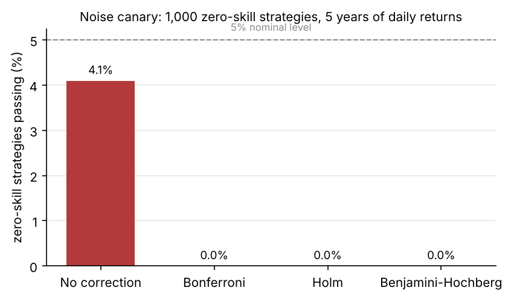
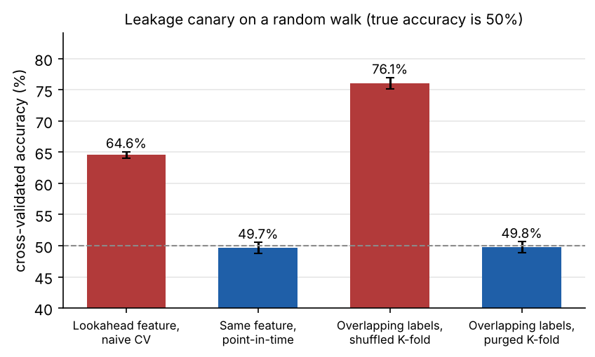
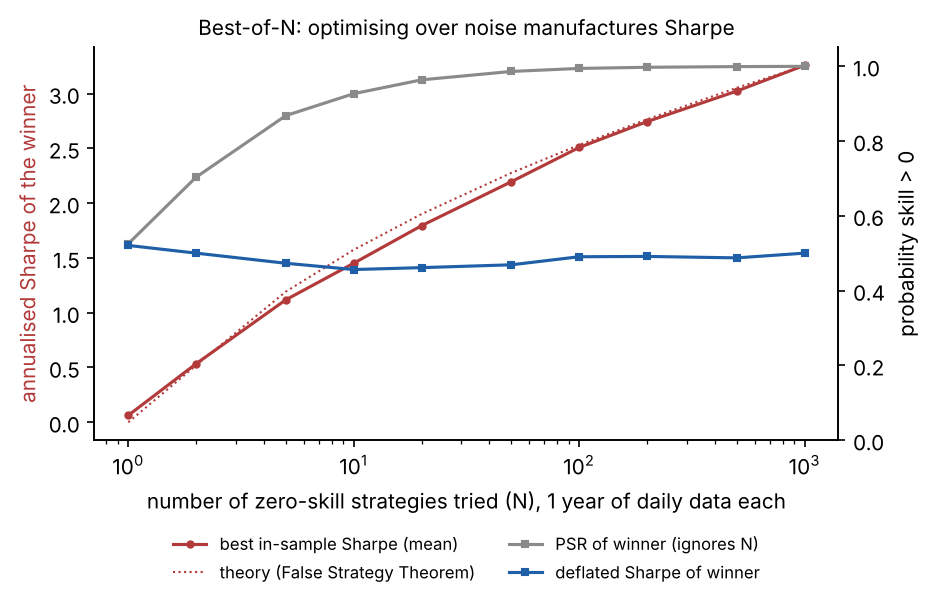
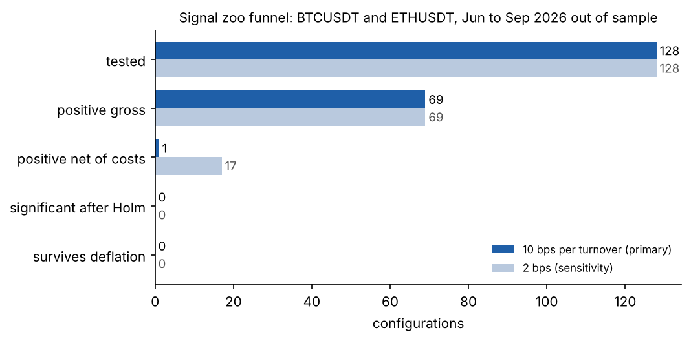
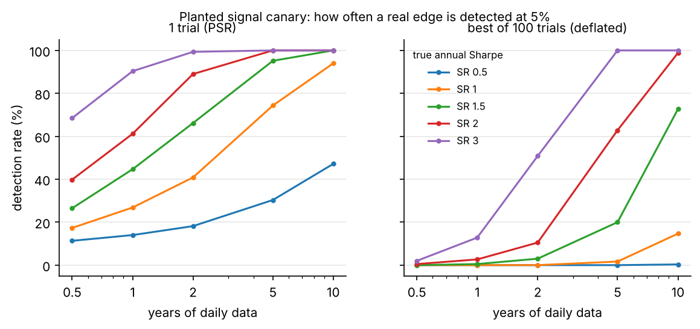

# Skeptic

**How many of the usual trading signals survive costs and honest statistics, and how do you know your validation tooling isn't fooling you?**


Skeptic is a small Python library for testing trading hypotheses without fooling yourself: point-in-time data access, purged and combinatorial cross-validation, Sharpe inference that accounts for fat tails and for the number of trials you ran, and a ledger that records every trial so the count cannot hide. It validates itself by simulation, and it is used by the two studies it was built for, [ExecLab](https://github.com/athish-shubhan/execlab) and the [AUD Cost Atlas](https://github.com/athish-shubhan/aud-cost-atlas).

## Key findings

- **Noise canary.** Of 1,000 zero-skill strategies with fat-tailed returns (5 years of daily data each), **4.1%** pass a 5% significance test with no correction, and **0.0%** pass after Bonferroni, Holm or Benjamini-Hochberg. The luckiest one has an annualised Sharpe of **1.23** and a probabilistic Sharpe of **0.997**, but a deflated Sharpe of **0.32**, so deflation correctly calls it noise.
- **Leakage canary.** On a pure random walk, where true accuracy is 50%, a feature that peeks one bar ahead scores **64.6%** under naive cross-validation, and **49.7%** once the same feature goes through the point-in-time rule. Overlapping forward labels score **76.1%** under shuffled K-fold and **49.8%** under purged K-fold with an embargo (means over 10 seeds).
- **Power canary.** A real edge with an annual Sharpe of 1.0 is detected **27%** of the time with one year of daily data and **74%** with five. If it was the best of 100 trials, those fall to **0%** and **2%**. Honest statistics need a lot of data.
- **Signal zoo (pre-registered).** 128 configurations of 8 signal families on BTCUSDT and ETHUSDT, out of sample from June to September 2026. **69** are positive before costs, **1** is positive after a 10 bps cost per unit turnover, and **0** survive Holm correction or deflation. Even at a generous 2 bps, 17 are positive net and none survive.
- **What failed.** The XGBoost direction model had some of the highest gross Sharpe ratios in the zoo (up to 2.1 annualised on BTCUSDT 15-minute bars) and one of the worst net results, because it turned over about half its position every bar.

## Charts

| | |
|---|---|
|  |  |
|  |  |



## Method

Every trial is logged to a SQLite ledger with its parameters, data window, seed and git hash. Significance uses the probabilistic Sharpe ratio, which adjusts the Sharpe standard error for skew and kurtosis (Lo, 2002; Mertens, 2002). The deflated Sharpe ratio (Bailey and Lopez de Prado, 2014) raises the bar to the Sharpe you would expect from the best of N zero-skill trials, with N read from the ledger. Family-wise error is controlled with Holm. Intervals come from a vectorised stationary block bootstrap (Politis and Romano, 1994). The signal zoo grid, cost assumption and pass criteria were committed in [`preregistration.md`](preregistration.md) before the zoo ran; `git log` shows the order.

## Library

| Module | What it does |
|---|---|
| `skeptic.pit` | `PITStore`: each record has an event time and an available-at time. `view(t)` and `align()` only return rows available at the decision time. Adding a table without an explicit latency raises an error. |
| `skeptic.splits` | `WalkForward` (expanding or rolling), `PurgedKFold` and `CombinatorialPurged` (CPCV with path reassembly), all with purging and embargo. |
| `skeptic.costs` | `FixedBps`, `SpreadCost`, `ImpactCost` (takes any curve, such as ExecLab's book-walk curve, or a square-root reference), and a `backtest` that always returns gross and net. |
| `skeptic.stats` | Sharpe confidence interval, PSR, deflated Sharpe, expected maximum Sharpe, minimum track record length, max drawdown. |
| `skeptic.boot` | Vectorised stationary block bootstrap for any statistic; group (day) bootstrap. |
| `skeptic.multiple` | Bonferroni, Holm, Benjamini-Hochberg adjusted p-values. |
| `skeptic.pbo` | Probability of Backtest Overfitting via combinatorially symmetric cross-validation. |
| `skeptic.ledger` | Trial ledger and an Optuna callback that logs every trial. |
| `skeptic.tearsheet` | One-page HTML tearsheet with a plain-language verdict. Refuses to render if the ledger has no trials for the study. |

```python
from skeptic import Ledger, deflated_sharpe_ratio, PurgedKFold
from skeptic.tearsheet import render

ledger = Ledger("ledger.sqlite")
for params in grid:
    net, gross = run_backtest(params)            # your code
    ledger.log("my_study", "momentum", params, net, gross_returns=gross)

s = ledger.summary("my_study")
dsr = deflated_sharpe_ratio(best_net, s.n_trials, s.sr_variance)
render(best_net, gross=best_gross, ledger=ledger, study="my_study", out="tearsheet.html")
```

## Quickstart (under 2 minutes)

```bash
pip install -e ".[ml,dev]"
make test          # unit and property tests
make reproduce     # canaries (quick mode) + zoo on the checked-in 2-month sample
```

Full results: put the Binance monthly 1-minute kline zips in `../data/binance/` and run `make zoo`. `skeptic run config.yaml` runs any grid from a YAML file (see [`configs/example.yaml`](configs/example.yaml)).

## Notebooks and note

- [`notebooks/canaries.ipynb`](../notebooks/canaries.ipynb): the four canaries, re-run live where they are quick.
- [`notebooks/signal_zoo.ipynb`](../notebooks/signal_zoo.ipynb): the funnel, the best configurations and overfitting probability.
- [How many of the usual signals survive costs and honest statistics? (4-page research note, PDF)](note.pdf)

## Used by

- [ExecLab](https://github.com/athish-shubhan/execlab): purged walk-forward splits with an embargo for model tuning, the trial ledger (160 Optuna trials logged) and block-bootstrap intervals on every headline number.
- [AUD Cost Atlas](https://github.com/athish-shubhan/aud-cost-atlas): bootstrap bands for the event study and Holm correction across currency pairs and event types.

## Limitations

- The zoo covers four months of out-of-sample data in a single market regime. "Nothing survived" is a statement about these signals, costs and months, not about crypto in general.
- The primary cost (10 bps per unit turnover) is Binance's base-tier taker fee. Real costs for a large participant are lower on fees and higher on impact. The 2 bps sensitivity run shows the conclusion does not depend on that choice.
- The deflated Sharpe uses the cross-trial variance of Sharpe ratios, as Bailey and Lopez de Prado prescribe. At 10 bps that variance is driven by turnover, which makes deflation very strict. With the gentler zero-skill variance instead, the best configuration's deflated Sharpe is still only 0.007 at 10 bps and 0.07 at 2 bps.
- Probability of backtest overfitting is near zero for 15-minute bars at 10 bps. That is not reassurance: when costs dominate, the in-sample winner is simply the configuration that trades least, and that ranking persists out of sample.
- Order-book signals (book imbalance, microprice) are excluded here because klines have no book; ExecLab tests them on the recorded book.
- Part B of the pre-registration (AUD pairs) has not been run yet; it is waiting on FX quote data.

## Reproduce

| Command | Output |
|---|---|
| `make test` | 31 unit and property tests |
| `make canaries` | `reports/canary_*.png`, `reports/canaries.json` (about 45 seconds) |
| `make zoo` | `reports/zoo_*.csv`, `reports/zoo_funnel.png`, best-of-N tearsheets (about 2 minutes) |
| `make reproduce` | quick canaries and the sample zoo, for CI |
| `make notebooks` | rebuild and execute both notebooks |

## How this transfers to FX and rates

The same machinery applies unchanged to rates and FX research: the point-in-time store is what you need for macro releases with revisions, purged splits matter even more for multi-day holding periods with overlapping labels, and the ledger is the honest answer to "how many things did you try before this one worked?".

## References

Bailey, D. and Lopez de Prado, M. (2014). The Deflated Sharpe Ratio. *Journal of Portfolio Management*.
Bailey, D., Borwein, J., Lopez de Prado, M. and Zhu, Q. (2017). The Probability of Backtest Overfitting. *Journal of Computational Finance*.
Holm, S. (1979). A Simple Sequentially Rejective Multiple Test Procedure. *Scandinavian Journal of Statistics*.
Lo, A. (2002). The Statistics of Sharpe Ratios. *Financial Analysts Journal*.
Lopez de Prado, M. (2018). *Advances in Financial Machine Learning*. Wiley.
Politis, D. and Romano, J. (1994). The Stationary Bootstrap. *JASA*.
