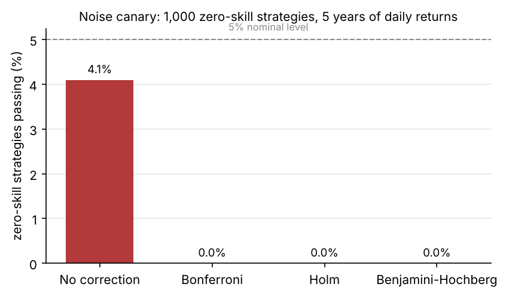
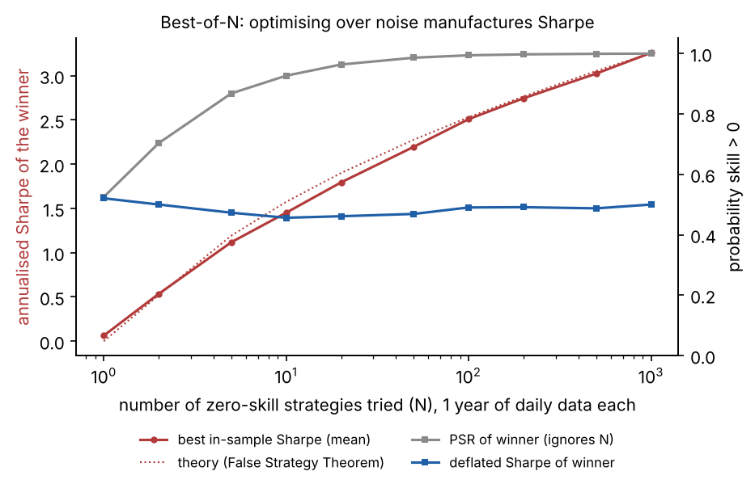
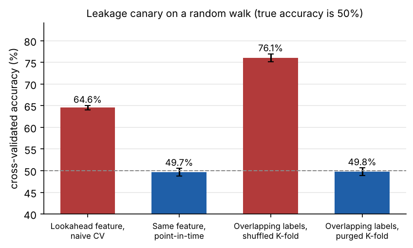
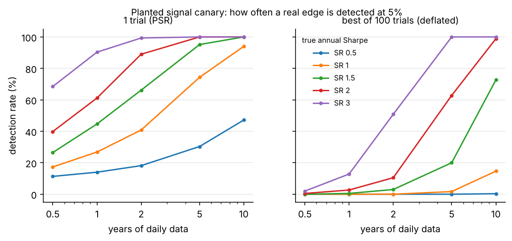
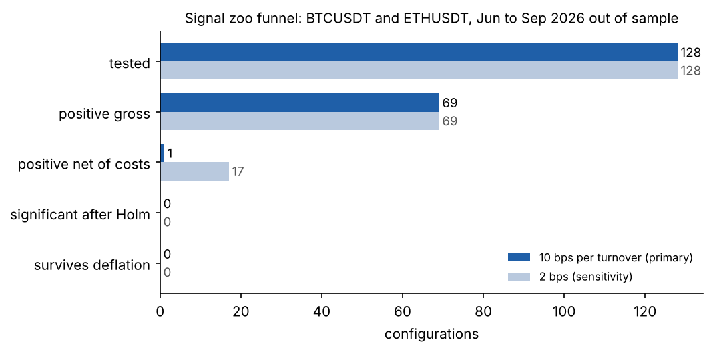

# How many of the usual signals survive costs and honest statistics?

*Athish Shubhan, October 2026. Research note accompanying the Skeptic library.*

## 1. Question

A backtest with a high Sharpe ratio is cheap to produce. Try enough signals and parameters on enough data, and one of them will look good by chance. This note asks two questions. First, does a small validation toolkit (purged splits, deflated Sharpe ratios, multiple-testing control and a trial ledger) actually catch false discoveries, measured on simulations where the truth is known? Second, when that toolkit is applied to eight familiar signal families on liquid crypto pairs, how many survive?

## 2. Does the toolkit work? Four canaries

**Noise.** I generated 1,000 strategies with zero true skill, each with 1,260 daily returns drawn from a Student-t distribution with 5 degrees of freedom (fat tails, like real returns). At the 5% level, 4.1% passed a one-sided Sharpe test with no correction, close to the nominal 5%. After Bonferroni, Holm or Benjamini-Hochberg correction, none passed. The best of the 1,000 had an annualised Sharpe of 1.23 and a probabilistic Sharpe ratio (PSR) of 0.997, which looks like a discovery. Its deflated Sharpe ratio (DSR), which compares it to the Sharpe expected from the best of 1,000 zero-skill trials, was 0.32. The DSR got this case right and the PSR did not.

**Best-of-N.** The same effect as a curve: the mean annualised Sharpe of the best of N zero-skill strategies on one year of daily data rises from about 0 at N = 1 to about 3.3 at N = 1,000, matching the expected-maximum formula behind the DSR. The PSR of the winner climbs towards 1 as N grows, while its DSR stays near 0.5, as it should for a strategy whose Sharpe sits exactly at the level expected from luck.

**Leakage.** Two leaks were planted in a random walk, where true predictive accuracy is 50%. A feature containing the next bar's return scored 64.6% under shuffled cross-validation. Built through the point-in-time store, which only exposes a value once its bar has closed, the same feature scored 49.7%. Forward labels over 20 bars overlap heavily; with smooth features a random forest memorises neighbouring samples and scored 76.1% under shuffled K-fold, but 49.8% under purged K-fold with a 20-bar embargo. Each number is a mean over 10 random seeds.

**Power.** Skepticism has a price. A strategy with a true annual Sharpe of 1.0 is detected 27% of the time with one year of daily data, and 74% with five. If the same strategy was the best of 100 trials, detection falls to 0% at one year and 2% at five, and even a Sharpe of 2.0 needs about five years to be found more often than not. These numbers are the reason to pre-register and to keep N small.

## 3. The signal zoo

**Design.** Pre-registered in `preregistration.md` and committed before the run. Data: Binance spot 1-minute klines for BTCUSDT and ETHUSDT, April to September 2026, resampled to 15-minute and 60-minute bars. April and May are used only to warm up rolling windows and fit the two fitted models; every metric is computed on June to September. Signals: time-series momentum, z-score mean reversion, Bollinger breakout, RSI contrarian, volatility breakout, taker-flow imbalance, a fitted time-of-day seasonality and an XGBoost direction classifier refit monthly on an expanding window. That gives 32 configurations per dataset and 128 in total, all logged. Positions are -1, 0 or +1, decided at the close of bar t and earning bar t+1. The primary cost is 10 bps per unit turnover, the Binance base-tier taker fee. A 2 bps sensitivity is reported but cannot be used to claim a result.

**Result.** The funnel at the primary cost:

| Stage | 10 bps (primary) | 2 bps (sensitivity) |
|---|---|---|
| Tested | 128 | 128 |
| Positive gross Sharpe | 69 | 69 |
| Positive net of costs | 1 | 17 |
| Significant after Holm | 0 | 0 |
| Survives deflation (DSR > 0.95) | 0 | 0 |

About half the configurations are positive before costs, which is what you would expect if most have no skill. Costs remove almost all of them. The one survivor at 10 bps, a volatility breakout on 60-minute ETHUSDT bars (48-bar lookback, 3 standard deviations), has a gross annualised Sharpe of 2.95 and a net Sharpe of 0.47, with a one-sided p-value of 0.39 before any correction. It is not distinguishable from noise.

**The instructive failure.** The XGBoost classifier had some of the best gross Sharpe ratios in the zoo, up to 2.1 annualised on BTCUSDT 15-minute bars, and some of the worst net ones, because its predicted direction flipped often enough to turn over about half its position every bar. A model can be right more often than not and still lose money. Accuracy is the wrong objective when every change of mind costs 10 bps.

## 4. Caveats

Four months of out-of-sample data is short, and it is one regime. The deflated Sharpe here uses the cross-trial Sharpe variance; at 10 bps that variance is mostly driven by turnover differences, which makes deflation very strict. Using the zero-skill variance instead does not change the conclusion: the best configuration's DSR is 0.007 at 10 bps and 0.07 at 2 bps. Probability of backtest overfitting is near zero for 15-minute bars at 10 bps, which is a warning about the metric rather than reassurance: when costs dominate, the in-sample winner is the configuration that trades least, and that stays true out of sample. Order book signals are left to ExecLab, which has the book.

## 5. What I take from it

The toolkit behaves as designed on known truths: it holds false positives to their nominal rate, catches both kinds of leakage, and tells you in advance how much data a real edge needs. On real data, none of the 128 standard configurations survived, and the reason was mostly cost rather than statistics. The useful next step is not a cleverer signal but a cheaper way to trade, which is the question ExecLab takes up.
